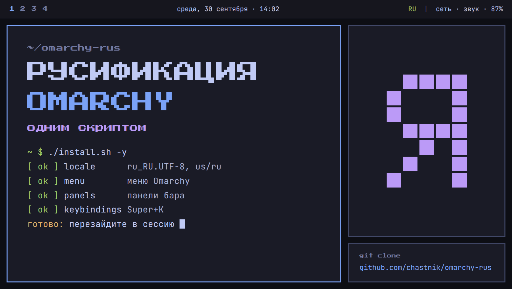
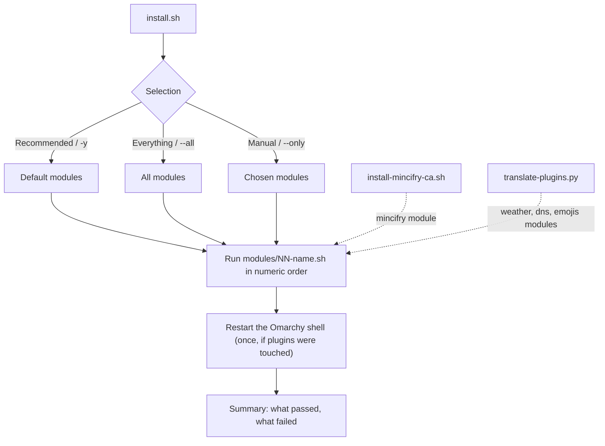
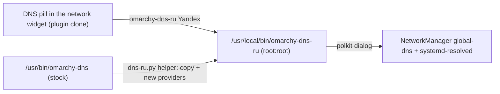
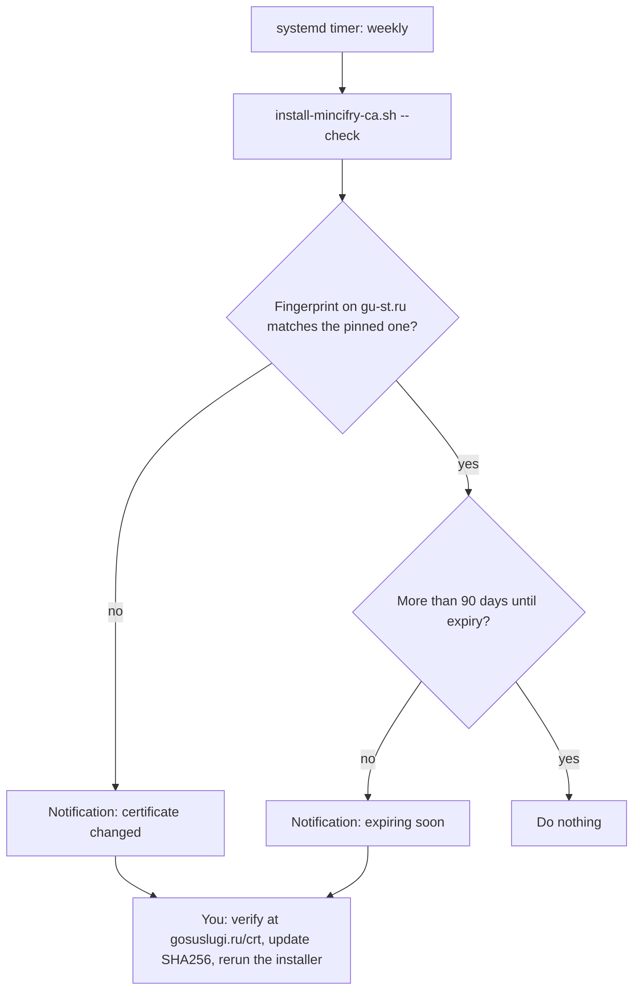

# omarchy-rus

🌐 [Русский](README.md) · **English**

[](https://github.com/chastnik/omarchy-rus/actions/workflows/ci.yml)
[](https://github.com/chastnik/omarchy-rus/releases/latest)
[](LICENSE)
[](https://omarchy.org)
[](https://github.com/chastnik/omarchy-rus/stargazers)
[](https://github.com/chastnik/omarchy-rus/commits/main)



Russian localization for Omarchy (Arch + Hyprland): locale, keyboard layout, speech input, DNS, Russian Ministry
root certificates and other Russia-specific extras. Since Omarchy 4.5 the UI itself (menu, bar, panels, Super+K,
notifications) is translated by Omarchy: the `locale` module turns it on with `omarchy language ru`, and omarchy-rus adds
what the built-in localization does not cover. Everything is a set of independent **modules**; when you run `install.sh`
you assemble a "basket" of the ones you want.

## Installation step by step
You need: Omarchy, a regular (non-root) user, a terminal and `sudo`.

1. **Download the archive** of the latest release: open the [releases page](https://github.com/chastnik/omarchy-rus/releases/latest)
   and click `omarchy-rus.tar.gz`. Or in one terminal command:
   ```bash
   curl -fLO https://github.com/chastnik/omarchy-rus/releases/latest/download/omarchy-rus.tar.gz
   ```
2. **Verify integrity** (optional). Download `omarchy-rus.tar.gz.sha256` next to it and run in the same folder:
   ```bash
   sha256sum -c omarchy-rus.tar.gz.sha256      # expected: omarchy-rus.tar.gz: OK
   ```
3. **Unpack and enter the folder:**
   ```bash
   tar xzf omarchy-rus.tar.gz && cd omarchy-rus
   ```
4. **See what the installer can do** (optional): `./install.sh --list`
5. **Run the installation:**
   ```bash
   ./install.sh
   ```
   Pick "Recommended", "Everything" or "Pick manually" (Space toggles, Enter continues). Enter your `sudo` password when asked.
6. **Log out and back in** so the interface language takes effect.

**Updating:** download the new release and repeat steps 1–5; the installer is idempotent. Installed archive version: `./install.sh --version`.
**From 1.x to 2.0:** first update Omarchy to 4.5+ (`omarchy update`; on older versions the installer stops), then run
`./install.sh` with "Recommended". The `migrate` module removes the old translation, the network, weather and emoji clones
are recreated in place of the old ones (widget settings are kept), and `locale` turns on the built-in Russian. Log out and back in.
**Without a release (latest from the repository):** `git clone https://github.com/chastnik/omarchy-rus && cd omarchy-rus && ./install.sh`.

## Quick start
    ./install.sh                # interactive: "Recommended" / "Everything" / "Pick manually"
    ./install.sh --list         # module catalog with descriptions
    ./install.sh --all          # everything, including optional (e-signature, Ministry certificates)
    ./install.sh -y             # recommended only, no prompts
    ./install.sh --only timezone,telegram     # only the given ids (see --list)
    ./install.sh --skip voxtype,tts           # recommended, except the given ones
    ./install.sh --dry-run ...  # print what would run and exit

Selection UI: `gum` (ships with Omarchy; Space toggles, Ctrl+A selects all), with a plain text menu as fallback.
Modules that need `sudo` ask for the password once. A failing module does not stop the rest; a summary is printed at the end.
The Omarchy shell is restarted once at the end if plugins were changed. Log out and back in afterwards.

## Modules
| id | Group | Default | What it does |
|----|-------|:---:|------------|
| `migrate` | Base | ✓ | cleanup after omarchy-rus 1.x: menu extension, own Super+K menus, fastfetch config, 1.x plugin clones, the old hook (see below) |
| `locale` | Base | ✓ | `omarchy language ru` (Omarchy's built-in translation), system `LANG=ru_RU.UTF-8`, `us,ru` layout (Left Alt + Right Alt) |
| `hypr-layout` | Base | ✓ | `us,ru` in `~/.config/hypr/input.lua` (with backup), Hyprland reload |
| `spell` | Base | ✓ | `hunspell-ru`, `aspell-ru`, `man-pages-ru` |
| `timezone` | Simple | ✓ | timezone (`Europe/Moscow`, `RUS_TZ` variable) and `ru.pool.ntp.org` for timesyncd |
| `xcompose` | Simple | ✓ | block in `~/.XCompose`: `₽` `№` `«»` `—` `–` `…` (Compose = Caps Lock) |
| `touchpad-scroll` | Simple | — | natural (MacBook-style) touchpad scrolling in `~/.config/hypr/input.lua` (with backup) |
| `touchpad-gestures` | Simple | — | three-finger horizontal swipe to switch workspaces (with backup) |
| `vconsole-font` | Simple | ✓ | Cyrillic TTY font (`LatArCyrHeb-16`), takes effect after reboot |
| `office` | Simple | ✓ | LibreOffice: Russian pack, hyphenation, thesaurus (if LibreOffice is installed) |
| `telegram` | Apps | ✓ | `telegram-desktop` |
| `browsers` | Apps | ✓ | Chromium/Brave/Chrome: `--lang=ru` and `--accept-lang` in the flags file; Firefox: `firefox-i18n-ru` package |
| `piper` | Apps | — | neural Russian Piper voice (Irina, offline), the `say-ru` command and a speech-dispatcher module |
| `weather` | Apps | ✓ | weather widget: `unit=metric`, city search in the UI language (plugin clone) |
| `dns` | Apps | ✓ | Russia-friendly DNS pills in the network widget (Yandex, DNS4EU, NextDNS) + root helper `omarchy-dns-ru` |
| `voxtype` | Apps | ✓ | Russian speech recognition (Parakeet), see below |
| `emojis` | UI | ✓ | emoji search by Russian names (plugin clone, CLDR) |
| `tts` | UI | ✓ | `speech-dispatcher` + `espeak-ng`, Russian as the default language |
| `post-update-hook` | UI | — | `post-update.d` hook: after `omarchy update` warns if the originals of the clones (network, weather, emojis) changed |
| `ecp` | Work | — | PC/SC for e-signatures: `pcsclite`, `ccid`, `opensc`, `pcsc-tools`, `pcscd` |
| `mincifry` | Work | — | Ministry certificates + weekly expiry check |



## Project layout
| File | Purpose |
|------|---------|
| `install.sh` | orchestrator: module selection, sudo, execution, summary |
| `modules/NN-name.sh` | modules; metadata in the header (`title`, `group`, `default`, `sudo`, `desc`). Drop your own file here to add one |
| `.github/workflows/` | CI (`ci.yml`) and tag-triggered release build (`release.yml`) |
| `dns-ru.py` | root-helper generator and network widget patch for the `dns` module |
| `translate-plugins.py` | network, weather, emojis plugin clones; `./translate-plugins.py [name…] [--except name…]`, `--check [--notify]`, `--refresh [name…]` |
| `data/emojis-ru.json` | Russian emoji names (CLDR) for search |
| `CHANGELOG.md` | changelog; the version's section becomes the release notes |
| `install-mincifry-ca.sh` | Ministry certificates and expiry monitoring |
| `input.lua.snippet` | snippet appended to `~/.config/hypr/input.lua` |

## Deliberately not included
- **Russian pacman mirrors.** Omarchy uses its own "stable" mirror `stable-mirror.omarchy.org`, which pins package versions;
  replacing `mirrorlist` (e.g. via `reflector`) would break that model.
- **Our own UI translation.** Since Omarchy 4.5 it ships in Omarchy itself (`/usr/share/omarchy/default/i18n/ru/`);
  translation fixes are better sent to [omacom/omarchy](https://github.com/omacom/omarchy) than kept as a parallel dictionary.
- **Screensaver.** `screensaver.txt` is an ASCII logo; nothing to translate.
- **Lock screen and the polkit dialog.** Authentication plugins are not cloned: a bug in a clone could lock you out.
- **CryptoPro CSP, Rutoken/JaCarta drivers, 1C** are proprietary and need registration; the `ecp` module installs only the
  open part (PC/SC) and prints links.

## Notes
- Fonts (Noto, Liberation) already support Cyrillic; `fcitx5` is installed.
- Firefox: `omarchy pkg add firefox-i18n-ru`. Chromium and LibreOffice take their language from the system
  (LibreOffice may need a separate language pack).
- To keep the English UI but type in Russian: `omarchy language en` (or Setup → Language).
- Files in `/usr/share/omarchy/` are never touched — only `~/.config/`.

## voxtype (voice input)
The `voxtype` module enables the ONNX build of voxtype (`sudo voxtype setup onnx --enable`), downloads
`parakeet-tdt-0.6b-v3-int8` (multilingual, Russian supported) and switches to `engine = "parakeet"` only after a
successful download.
Known issue: `models.voxtype.io` can serve the ~650 MB file very slowly; on failure the script fetches the same files from the
Hugging Face mirror (`istupakov/parakeet-tdt-0.6b-v3-onnx`) with resume and sha256 verification.

### If voxtype returns empty text or English garbage
Check the microphone level: on some laptops `Internal Mic Boost` = 100% and `Capture` = 100% cause clipping (peak 32768).
The script sets Boost=1, Capture=60% (`amixer -c 0 ...`).
Diagnostics: `arecord -D default -f S16_LE -r 16000 -c 1 -d 5 t.wav && voxtype transcribe t.wav`.

## Omarchy's built-in translation (`locale`, `migrate`)
Since 4.5 Omarchy has localization: the `menu.json`, `shell.json`, `keybindings.json` and `cli.json` catalogs in
`/usr/share/omarchy/default/i18n/ru/` cover the menu, the bar and panels, the keybindings menu, notifications and About.
The `locale` module turns it on (`omarchy language ru`: the `~/.config/omarchy/language` file and the session `LANG` via uwsm).
The language can also be switched from the menu: Setup → Language.

Before 4.5 omarchy-rus translated all of this itself: a menu extension (`translate-menu.py`), its own copies of the Super+K
menus (`keybindings-ru.py`), bar plugin clones with dictionaries, notification translation, a fastfetch config, and a post-update hook that rebuilt all of it. The
`migrate` module removes these leftovers (only what omarchy-rus created, by markers and a list of clones; other files are
left alone): `omarchy plugin remove` puts the original plugin back in the clone's place on the bar, and a backup of the
clone stays in `~/.config/omarchy/plugins/.<user>.<name>.bak.*`. The 1.x network, weather and emoji clones are removed
too: the `dns`, `weather` and `emojis` modules recreate them (the widget returns to its place with its settings). The old
hook is replaced with the new one. On a clean system the module does nothing; on Omarchy without built-in localization it stops.

## Plugin clones (`translate-plugins.py`)
Built-in plugins live in `/usr/share/omarchy/` and must not be edited, so three plugins are cloned
(`omarchy plugin clone`; clones are `~/.config/omarchy/plugins/<user>.<name>`, listed as "My …"):

| Clone | Why |
|-------|-----|
| `network` | Russia-friendly DNS provider pills (the `dns` module, see below) |
| `weather` | city search in the UI language: the stock geocoder always asks for `language=en` (a `PATCHES` entry) |
| `emojis` | Russian names (CLDR, `data/emojis-ru.json`) are appended to the keywords: «сердце», «огонь», «кот» |

Strings in the clones are not translated: they come from Omarchy's catalogs through `I18n`, as in the originals.
**The downside of clones:** they do not receive updates of the original plugins. So the script records which original files
a clone was made from, and `./translate-plugins.py --check` shows which originals changed after `omarchy update`
(`--notify` sends a notification; the `post-update-hook` module does the same).
To recreate stale clones: `./translate-plugins.py --refresh` (optionally with plugin names; the DNS patch is re-applied).
To get the original back: `omarchy plugin remove <user>.<name> --yes`.

## DNS in the network widget (`dns`, `dns-ru.py`)
The stock pills are Cloudflare and Google, and `omarchy-dns` accepts only those (+ DHCP/Custom) and lives in `/usr/share/omarchy/`.
The module replaces them with **Yandex, DNS4EU, NextDNS** (+ DHCP and Custom). The idea and provider set were borrowed from
[WokoFlipper/omarchy-network-ru](https://github.com/WokoFlipper/omarchy-network-ru); the implementation is our own: no copy of the
whole plugin, only the network widget clone is patched.



- `dns-ru.py helper` generates `omarchy-dns-ru` from the stock script (all mechanics — NetworkManager, resolved, opportunistic DoT —
  stay stock), `dns-ru.py panel` patches the pills in the clone. The provider list is `PROVIDERS` at the top of `dns-ru.py`.
- The helper is installed **as root** (`root:root 0755`): a script that runs as root after confirmation must not be user-writable.
  Every DNS change asks for confirmation through polkit; there is no silent mode.
- If the stock `omarchy-dns` changes structure, the generator stops with a message instead of emitting a broken helper.
  After `omarchy update` rerun the module: `./install.sh --only dns`.
- The servers answered over IPv4 (UDP/53) at the time of writing. Reachability depends on your ISP — check on your side.
  Removal: `sudo rm /usr/local/bin/omarchy-dns-ru` and remove the network clone (`omarchy plugin remove $USER.network --yes`).

## Russian Ministry root certificates (`install-mincifry-ca.sh`)
Needed for Russian government sites and some banks. The script downloads Russian Trusted Root/Sub CA from gu-st.ru, checks
pinned SHA-256 fingerprints (aborts on mismatch) and installs them into the system store (`update-ca-trust`, needs sudo),
the Chromium-family NSS database (`~/.pki/nssdb`), and enables `security.enterprise_roots.enabled` in Firefox profiles.
Restart browsers afterwards.

| Command | Action |
|---------|--------|
| `./install-mincifry-ca.sh` | install (idempotent) |
| `./install-mincifry-ca.sh --remove` | remove from all stores |
| `./install-mincifry-ca.sh --check` | no-sudo check: fingerprints on gu-st.ru and expiry (< 90 days warns) |
| `./install-mincifry-ca.sh --enable-timer` / `--disable-timer` | weekly automatic check (systemd user timer `mincifry-ca-check.timer`) |



There is **deliberately no automatic installation** of new certificates: this is trust in a root authority, so on a fingerprint
change or expiry < 90 days you get a notification and the decision is yours: verify at gosuslugi.ru/crt, update the
`SHA256` values in the script and run it. Expiry: Sub CA 2027-03-06, Root CA 2032-02-27.
Kept separate from `install.sh` on purpose.

## License
MIT, see [LICENSE](LICENSE).
