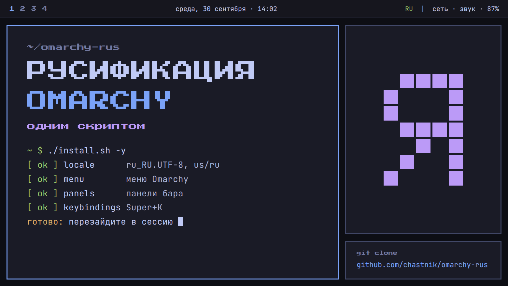
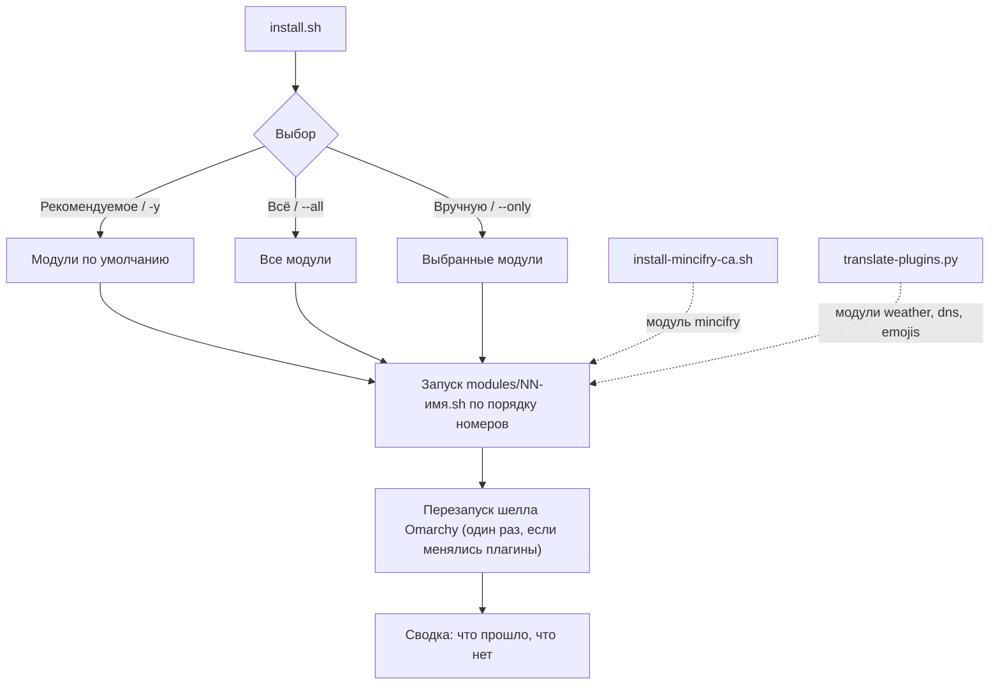
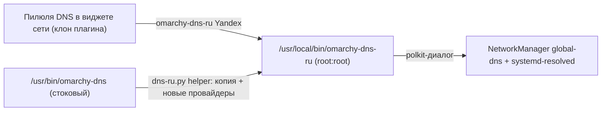
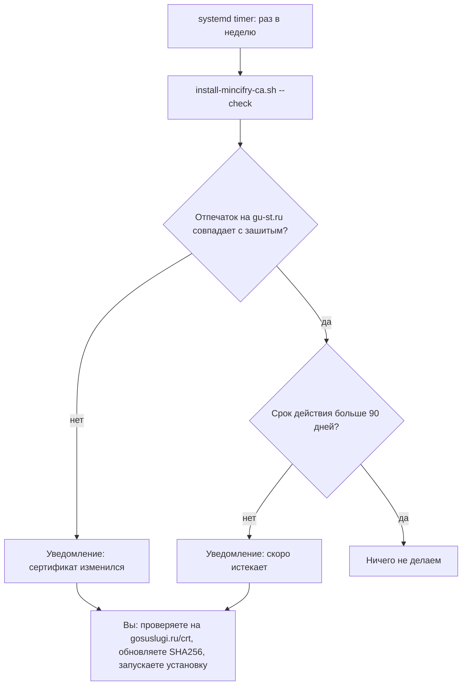

# omarchy-rus

🌐 **Русский** · [English](README.en.md)

[](https://github.com/chastnik/omarchy-rus/actions/workflows/ci.yml)
[](https://github.com/chastnik/omarchy-rus/releases/latest)
[](LICENSE)
[](https://omarchy.org)
[](https://github.com/chastnik/omarchy-rus/stargazers)
[](https://github.com/chastnik/omarchy-rus/commits/main)



Русификация Omarchy (Arch + Hyprland): локаль, раскладка, речь, DNS, сертификаты Минцифры и прочие «русские» мелочи.
С Omarchy 4.5 интерфейс (меню, бар, панели, Super+K, уведомления) переводит сам Omarchy — модуль `locale` включает его
командой `omarchy language ru`, а omarchy-rus добавляет то, чего во встроенной локализации нет.
Всё устроено как набор независимых **модулей**; при запуске `install.sh` вы собираете «корзину» из нужных.

## Установка по шагам
Нужно: Omarchy, обычный пользователь (не root), терминал и `sudo`.

1. **Скачайте архив** последнего релиза: откройте [страницу релизов](https://github.com/chastnik/omarchy-rus/releases/latest)
   и нажмите `omarchy-rus.tar.gz`. Либо одной командой в терминале:
   ```bash
   curl -fLO https://github.com/chastnik/omarchy-rus/releases/latest/download/omarchy-rus.tar.gz
   ```
2. **Проверьте целостность** (по желанию). Скачайте рядом `omarchy-rus.tar.gz.sha256` и выполните в той же папке:
   ```bash
   sha256sum -c omarchy-rus.tar.gz.sha256      # должно быть: omarchy-rus.tar.gz: ЦЕЛ (OK)
   ```
3. **Распакуйте и перейдите в папку:**
   ```bash
   tar xzf omarchy-rus.tar.gz && cd omarchy-rus
   ```
4. **Посмотрите, что умеет установщик** (по желанию): `./install.sh --list`
5. **Запустите установку:**
   ```bash
   ./install.sh
   ```
   Выберите «Рекомендуемое», «Всё» или «Выбрать вручную» (Пробел — отметить, Enter — продолжить). Введите пароль `sudo`, когда спросят.
6. **Перезайдите в сессию** (выйдите и войдите снова), чтобы применился язык интерфейса.

**Обновление:** скачайте новый релиз и повторите шаги 1–5; установщик идемпотентен. Версия установленного архива: `./install.sh --version`.
**С 1.x на 2.0:** сначала обновите Omarchy до 4.5+ (`omarchy update`; на более старых установщик остановится), затем
запустите `./install.sh` с «Рекомендуемым». Модуль `migrate` уберёт старый перевод, клоны сети, погоды и эмодзи будут
пересозданы на месте старых (с сохранением настроек виджетов), `locale` включит встроенный русский. Перезайдите в сессию.
**Без релиза (последняя версия из репозитория):** `git clone https://github.com/chastnik/omarchy-rus && cd omarchy-rus && ./install.sh`.

## Быстрый старт
    ./install.sh                # интерактивный выбор: «Рекомендуемое» / «Всё» / «Выбрать вручную»
    ./install.sh --list         # каталог модулей с описаниями
    ./install.sh --all          # всё, включая необязательное (ЭЦП, сертификаты Минцифры)
    ./install.sh -y             # только рекомендуемое, без вопросов
    ./install.sh --only timezone,telegram     # только указанные (id из --list)
    ./install.sh --skip voxtype,tts           # рекомендуемое, кроме указанных
    ./install.sh --dry-run ...  # показать, что будет выполнено, и выйти
    ./install.sh --plain ...    # без анимаций: полный вывод модулей прямо в терминал

Интерфейс выбора: `gum` (есть в Omarchy; Пробел — отметить, Ctrl+A — выбрать всё), без него — текстовое меню.
Модули, которым нужен `sudo`, запрашивают пароль один раз. Сбой одного модуля не останавливает остальные;
в конце выводится сводка. Шелл Omarchy перезапускается один раз в конце, если менялись плагины.
Во время установки у каждого шага крутится спиннер с таймером и последней строкой вывода, внизу — общий прогресс;
клавиша `v` разворачивает последние строки вывода. Полный журнал пишется в `~/.local/state/omarchy-rus/install-*.log`,
у упавших шагов показываются последние строки и команда для повтора. `RUS_NO_ANIM=1` отключает анимацию баннера, `NO_COLOR=1` — цвета.
После установки перезайдите в сессию.

## Модули
| id | Группа | По умолч. | Что делает |
|----|--------|:---:|------------|
| `migrate` | Базовая | ✓ | уборка за omarchy-rus 1.x: расширение меню, свои меню Super+K, конфиг fastfetch, клоны плагинов 1.x, старый хук (см. ниже) |
| `locale` | Базовая | ✓ | `omarchy language ru` (встроенный перевод Omarchy), системная `LANG=ru_RU.UTF-8`, раскладка `us,ru` (Left Alt + Right Alt) |
| `hypr-layout` | Базовая | ✓ | `us,ru` в `~/.config/hypr/input.lua` (с бэкапом), перезагрузка Hyprland |
| `spell` | Базовая | ✓ | `hunspell-ru`, `aspell-ru`, `man-pages-ru` |
| `timezone` | Простое | ✓ | часовой пояс (`Europe/Moscow`, переменная `RUS_TZ`) и `ru.pool.ntp.org` для timesyncd |
| `xcompose` | Простое | ✓ | блок в `~/.XCompose`: `₽` `№` `«»` `—` `–` `…` (Compose = Caps Lock) |
| `touchpad-scroll` | Простое | — | натуральная прокрутка тачпада (как на MacBook) в `~/.config/hypr/input.lua` (с бэкапом) |
| `touchpad-gestures` | Простое | — | жест тремя пальцами влево/вправо для смены рабочих столов (с бэкапом) |
| `vconsole-font` | Простое | ✓ | кириллический шрифт TTY (`LatArCyrHeb-16`), действует после перезагрузки |
| `office` | Простое | ✓ | LibreOffice: русский пакет, переносы, тезаурус (если LibreOffice установлен) |
| `telegram` | Приложения | ✓ | `telegram-desktop` |
| `browsers` | Приложения | ✓ | Chromium/Brave/Chrome: `--lang=ru` и `--accept-lang` в файле флагов; Firefox: пакет `firefox-i18n-ru` |
| `piper` | Приложения | — | нейросетевой русский голос Piper (Irina, офлайн), команда `say-ru`, модуль speech-dispatcher |
| `weather` | Приложения | ✓ | виджет погоды: `unit=metric`, поиск городов на языке интерфейса (клон плагина) |
| `dns` | Приложения | ✓ | пилюли DNS для России в виджете сети (Yandex, DNS4EU, NextDNS) + root-helper `omarchy-dns-ru` |
| `voxtype` | Приложения | ✓ | русское распознавание речи (Parakeet), см. ниже |
| `emojis` | Интерфейс | ✓ | поиск эмодзи по русским названиям (клон плагина, CLDR) |
| `tts` | Интерфейс | ✓ | `speech-dispatcher` + `espeak-ng`, язык по умолчанию — русский |
| `post-update-hook` | Интерфейс | — | хук `post-update.d`: после `omarchy update` предупреждает, если оригиналы клонов (сеть, погода, эмодзи) изменились |
| `ecp` | Работа | — | PC/SC для ЭЦП: `pcsclite`, `ccid`, `opensc`, `pcsc-tools`, `pcscd` |
| `mincifry` | Работа | — | сертификаты Минцифры + еженедельная автопроверка срока |



## Структура проекта
| Файл | Назначение |
|------|------------|
| `install.sh` | оркестратор: выбор модулей, sudo, запуск, сводка |
| `ui.sh` | оформление установщика: баннер, спиннер, прогресс, журнал |
| `tests/` | проверки для CI: метаданные модулей и таблицы README (`check-modules.py`), смоук-тест установщика (`ui-smoke.sh`) |
| `modules/NN-имя.sh` | модули; метаданные в шапке (`title`, `group`, `default`, `sudo`, `desc`). Чтобы добавить свой — положите файл сюда |
| `.github/workflows/` | CI (`ci.yml`) и сборка релиза по тегу (`release.yml`) |
| `dns-ru.py` | генератор root-helper и правка виджета сети для модуля `dns` |
| `translate-plugins.py` | клоны плагинов network, weather, emojis; `./translate-plugins.py [имя…] [--except имя…]`, `--check [--notify]`, `--refresh [имя…]` |
| `data/emojis-ru.json` | русские названия эмодзи (CLDR) для поиска |
| `CHANGELOG.md` | список изменений; раздел версии становится описанием релиза |
| `install-mincifry-ca.sh` | сертификаты Минцифры и мониторинг срока |
| `input.lua.snippet` | фрагмент для `~/.config/hypr/input.lua` |

## Чего здесь нет намеренно
- **Российские зеркала pacman.** Omarchy использует собственное «стабильное» зеркало `stable-mirror.omarchy.org`,
  которое фиксирует версии пакетов; замена `mirrorlist` (например, через `reflector`) сломала бы эту модель.
- **Собственный перевод интерфейса.** С Omarchy 4.5 он есть в самом Omarchy (`/usr/share/omarchy/default/i18n/ru/`);
  замечания к переводу лучше отправлять в [omacom/omarchy](https://github.com/omacom/omarchy), чем держать параллельный словарь.
- **Заставка.** `screensaver.txt` — это ASCII-логотип, переводить нечего.
- **Экран блокировки и polkit-окно.** Плагины аутентификации не клонируются: ошибка в клоне может оставить без входа.
- **КриптоПро CSP, драйверы Рутокен/JaCarta, 1С** — проприетарные, требуют регистрации; модуль `ecp` ставит только
  открытую часть (PC/SC) и печатает ссылки.

## Заметки
- Шрифты (Noto, Liberation) уже поддерживают кириллицу; `fcitx5` установлен.
- Firefox: `omarchy pkg add firefox-i18n-ru`. Chromium и LibreOffice берут язык из системы
  (для LibreOffice может понадобиться отдельный language pack).
- Чтобы оставить английский интерфейс, но печатать по-русски: `omarchy language en` (или «Настройка → Язык»).
- Файлы Omarchy в `/usr/share/omarchy/` не трогаем — только `~/.config/`.

## voxtype (голосовой ввод)
Модуль `voxtype` включает ONNX-сборку voxtype (`sudo voxtype setup onnx --enable`), скачивает
`parakeet-tdt-0.6b-v3-int8` (мультиязычная, русский поддерживается) и только после успешной
загрузки переключает `engine = "parakeet"`.
Известная проблема: `models.voxtype.io` может отдавать файл (~650 МБ) очень медленно;
при неудаче скрипт качает те же файлы с зеркала Hugging Face (`istupakov/parakeet-tdt-0.6b-v3-onnx`) с докачкой и проверкой sha256.

### Если voxtype выдаёт пустой текст или английский мусор
Проверьте уровень микрофона: на некоторых ноутбуках `Internal Mic Boost` = 100% и `Capture` = 100%
дают клиппинг (peak 32768). Скрипт ставит Boost=1, Capture=60% (`amixer -c 0 ...`).
Диагностика: `arecord -D default -f S16_LE -r 16000 -c 1 -d 5 t.wav && voxtype transcribe t.wav`.

## Встроенный перевод Omarchy (`locale`, `migrate`)
С версии 4.5 в Omarchy есть локализация: каталоги `menu.json`, `shell.json`, `keybindings.json`, `cli.json` в
`/usr/share/omarchy/default/i18n/ru/` покрывают меню, бар и панели, меню горячих клавиш, уведомления и About.
Модуль `locale` включает её (`omarchy language ru`: файл `~/.config/omarchy/language` и `LANG` сессии через uwsm).
Язык переключается и из меню: «Настройка → Язык».

До 4.5 omarchy-rus переводил всё это сам: расширение меню (`translate-menu.py`), свои копии меню Super+K
(`keybindings-ru.py`), клоны плагинов бара со словарями, перевод уведомлений, конфиг fastfetch, хук post-update, который всё это пересобирал. Модуль `migrate`
убирает эти остатки (только созданное omarchy-rus, по маркерам и списку клонов; чужие файлы не трогаются):
`omarchy plugin remove` возвращает оригинальный плагин на место клона в баре, резервная копия клона остаётся
в `~/.config/omarchy/plugins/.<user>.<имя>.bak.*`. Клоны сети, погоды и эмодзи из 1.x тоже убираются: их заново
создают модули `dns`, `weather`, `emojis` (виджет встаёт на прежнее место с прежними настройками). Старый хук заменяется
новым. На чистой системе модуль ничего не делает; на Omarchy без встроенной локализации останавливается.

## Клоны плагинов (`translate-plugins.py`)
Встроенные плагины лежат в `/usr/share/omarchy/` и правке не подлежат, поэтому три плагина клонируются
(`omarchy plugin clone`; клоны `~/.config/omarchy/plugins/<user>.<имя>`, в списке плагинов — «My …»):

| Клон | Зачем |
|------|-------|
| `network` | пилюли российских DNS-провайдеров (модуль `dns`, см. ниже) |
| `weather` | поиск города на языке интерфейса: стоковый геокодер всегда запрашивает `language=en` (правка `PATCHES`) |
| `emojis` | к ключевым словам дописываются русские названия (CLDR, `data/emojis-ru.json`): «сердце», «огонь», «кот» |

Строки в клонах не переводятся: они берутся из каталогов Omarchy через `I18n`, как и в оригиналах.
**Минус клонов:** они не получают обновления оригинальных плагинов. Поэтому скрипт запоминает, из каких файлов
оригинала сделан клон, и `./translate-plugins.py --check` показывает, какие оригиналы изменились после
`omarchy update` (с `--notify` присылает уведомление; то же делает модуль `post-update-hook`).
Пересоздать устаревшие клоны: `./translate-plugins.py --refresh` (или с именами плагинов; правка DNS применяется повторно).
Вернуть оригинал: `omarchy plugin remove <user>.<имя> --yes`.

## DNS в виджете сети (`dns`, `dns-ru.py`)
Стоковые пилюли — Cloudflare и Google, а `omarchy-dns` принимает только их (+ DHCP/Custom) и лежит в `/usr/share/omarchy/`.
Модуль заменяет их на **Yandex, DNS4EU, NextDNS** (+ DHCP и Custom). Идея и набор провайдеров подсмотрены в
[WokoFlipper/omarchy-network-ru](https://github.com/WokoFlipper/omarchy-network-ru); реализация своя: без копии всего плагина,
правится только клон виджета сети.



- `dns-ru.py helper` генерирует `omarchy-dns-ru` из стокового скрипта (все механики — NetworkManager, resolved, DoT opportunistic —
  остаются стоковыми), `dns-ru.py panel` правит пилюли в клоне. Список провайдеров — в `PROVIDERS` в начале `dns-ru.py`.
- Helper ставится **от root** (`root:root 0755`): скрипт, который исполняется от root после подтверждения, не должен быть
  доступен на запись пользователю. Каждая смена DNS запрашивает подтверждение через polkit, тихого режима нет.
- Если у стокового `omarchy-dns` изменится структура, генератор остановится с сообщением, а не выдаст битый helper.
  После `omarchy update` перезапустите модуль: `./install.sh --only dns`.
- Серверы на момент написания отвечали по IPv4 (UDP/53). Доступность зависит от провайдера связи — проверяйте у себя.
  Удаление: `sudo rm /usr/local/bin/omarchy-dns-ru` и уберите клон сети (`omarchy plugin remove $USER.network --yes`).

## Сертификаты Минцифры (`install-mincifry-ca.sh`)
Нужны для госсайтов и части банков. Скрипт скачивает Russian Trusted Root/Sub CA с gu-st.ru, сверяет
зафиксированные SHA-256 (при несовпадении прерывается) и ставит их в системное хранилище
(`update-ca-trust`, нужен sudo), в NSS-базу Chromium-браузеров (`~/.pki/nssdb`) и включает
`security.enterprise_roots.enabled` в профилях Firefox. После установки перезапустите браузеры.

| Команда | Действие |
|---------|----------|
| `./install-mincifry-ca.sh` | установка (идемпотентна) |
| `./install-mincifry-ca.sh --remove` | удаление из всех хранилищ |
| `./install-mincifry-ca.sh --check` | проверка без sudo: отпечатки на gu-st.ru и срок действия (< 90 дней — предупреждение) |
| `./install-mincifry-ca.sh --enable-timer` / `--disable-timer` | еженедельная автопроверка (systemd user timer `mincifry-ca-check.timer`) |



Автоустановки новых сертификатов **нет намеренно**: это доверие к корневому центру, поэтому при смене отпечатка
или сроке < 90 дней приходит уведомление, а решение принимаете вы: проверьте на gosuslugi.ru/crt, обновите
`SHA256` в скрипте и запустите его. Сроки: Sub CA до 2027-03-06, Root CA до 2032-02-27.
Отдельно от `install.sh` намеренно.

## Лицензия
MIT, см. [LICENSE](LICENSE).
